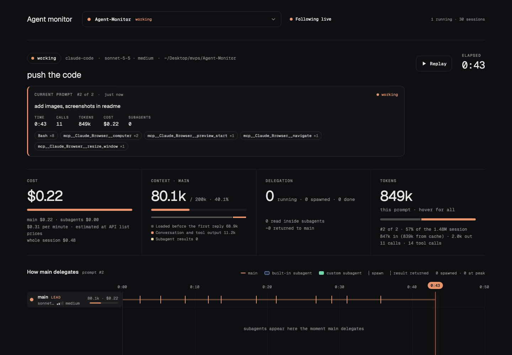
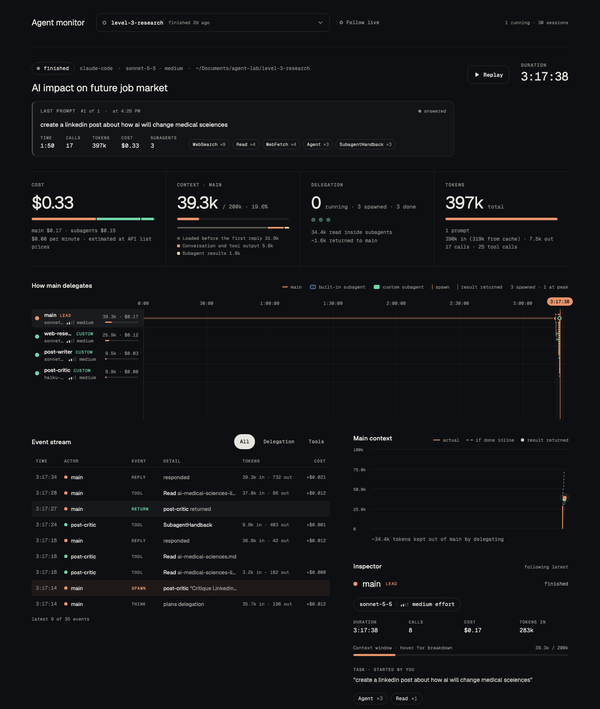

# Agent Monitor

A local, read-only dashboard for AI coding agents. It watches the session logs that **Claude Code**, **Codex** and **OpenCode** already write to your disk and shows, live:

- which sessions are running right now, and what each one is working on
- what the **current prompt** is doing: its tokens, cost, tool calls and subagents
- how the main agent **delegates** to subagents (built-in vs custom), with the model and effort each one runs on
- how full the **context window** is, and what fills it (hover for a breakdown)
- how much each prompt contributed to the session's total tokens

No account, no cloud, no dependencies. It is one Python file that serves one HTML page on `127.0.0.1`.

  



*Following a live session: the current prompt, cost, context window and tokens at a glance.*



*A finished session where the main agent delegated to three custom subagents: the delegation timeline, event stream, context chart and inspector.*

## Quick start

```bash
git clone https://github.com/muhammadmohsinjs-web/Agent-Monitor.git
cd Agent-Monitor
python3 server.py
```

Open <http://127.0.0.1:8765>. That is all. Leave it running and start a session in any supported tool; it appears within a few seconds.

Requirements: Python 3.7 or newer (standard library only). Tested on macOS; Linux should work as is.

## Supported tools

| Tool | Where it reads from | Cost shown |
|---|---|---|
| Claude Code | `~/.claude/projects/` | estimated from API list prices |
| Codex | `~/.codex/sessions/` | unpriced unless you add prices in `config.json` |
| OpenCode | `~/.local/share/opencode/opencode.db` (opened read-only) | as reported by the provider |

A tool whose folder doesn't exist is skipped, so you can have any subset installed. Point the monitor at other locations with `--projects`, `--codex` and `--opencode`.

## Using the dashboard

**Pick a session.** The dropdown at the top lists every session grouped as *Running*, *Recently active*, *Today*, *Yesterday* and *Earlier*. Type to search, switch the source tab (all / claude-code / codex / opencode), and use `/` to open it, `↑ ↓` to move, `Enter` to open a session and `Esc` to close.

**Follow live.** With *Following live* on, the dashboard jumps to whichever session is running (or the most recent one if nothing is). Pick a session yourself and following pauses, so the view stays put. Click the toggle to resume.

**Everything is about the current prompt.** The panel under the title shows the last prompt you sent, or the one currently running, with its time, calls, tokens, cost, subagents and the tools it used. The cost, delegation and token tiles, the timeline and the event stream all cover that prompt only.

**Look at an older prompt.** *Prompt history* at the bottom lists every prompt with its share of the session's tokens. Click one to inspect it; click *back to latest* to return.

**The tiles**

- **Cost**: this prompt, split into main vs subagents, plus the whole-session total.
- **Context · main**: how full the main agent's context window is. Hover for what fills it (system prompt and tools, conversation and tool output, subagent results).
- **Delegation**: subagents running / spawned / done for this prompt.
- **Tokens**: tokens consumed by this prompt (input + output, cached input included). The bar shows its share of the session; hover for every prompt.

**Timeline.** One lane per agent. Orange lines are spawns, dashed lines are results returning to main. Click a lane to inspect that agent: its task, model, effort, context breakdown, tools and the report it handed back. **Replay** plays the selected prompt back in time.

## How sessions are classified

| State | Rule |
|---|---|
| Running | a message was written in the last 60 seconds (or a subagent is still active) |
| Waiting for you | the last turn ended and it has been quiet for less than 30 minutes |
| Finished | quiet for more than 30 minutes |

For Claude Code this uses the timestamp of the last real message in the transcript, not the file's modified time, because editors, sync tools and indexers touch files without anything happening.

## Configuration

Optional. Copy `config.example.json` to `config.json` next to `server.py`:

```json
{
  "prices":  { "gpt-5.4": [1.25, 10.0, 0.125] },
  "windows": { "gpt-5.4": 400000 }
}
```

- `prices`: model-name prefix to `[input, output, cached input]`, in dollars per million tokens. Needed for Codex costs.
- `windows`: model-name prefix to context window size in tokens. Without it the monitor uses the window recorded in the log, else 200k, and raises it if a session goes past that.

Command line:

```bash
python3 server.py --port 8765 \
  --projects ~/.claude/projects \
  --codex ~/.codex/sessions \
  --opencode ~/.local/share/opencode/opencode.db
```

## Start it automatically

Pick one.

**macOS, at login (covers every tool):**

```bash
./autostart/install-launchd.sh
```

This installs a LaunchAgent that keeps the server running. To remove it: `launchctl bootout gui/$(id -u)/com.ccviz.server && rm ~/Library/LaunchAgents/com.ccviz.server.plist`.

**From a Claude Code hook.** `autostart/ensure.sh` starts the server only if it isn't already up. In `~/.claude/settings.json`:

```json
{
  "hooks": {
    "SessionStart": [
      { "hooks": [ { "type": "command", "command": "/absolute/path/to/Agent-Monitor/autostart/ensure.sh" } ] }
    ]
  }
}
```

**From OpenCode.** Copy `autostart/opencode-plugin.js` to `~/.config/opencode/plugins/agent-monitor.js` and set `AGENT_MONITOR_DIR` to the folder you cloned into (it defaults to `~/Agent-Monitor`).

`ensure.sh` honours `CCVIZ_PORT` if you run on another port.

## Pages and API

| URL | What |
|---|---|
| `/` | the dashboard |
| `/?key=<project>/<session>` | the Claude Code swarm view of one session |
| `/swarm`, `/detailed`, `/classic` | the earlier Claude Code views |
| `/api/health` | liveness check |
| `/api/overview?limit=30` | session list with live status |
| `/api/v2/session?key=<key>` | one session, normalised. Keys look like `claude:<project>/<session>`, `codex:<uuid>`, `opencode:<ses_id>` |

The server binds to `127.0.0.1` only and never writes to your logs.

## Adding another tool

Each tool is an adapter in `sources.py`: a class with three methods.

```python
class MyToolSource:
    name = "mytool"
    label = "mytool"
    def list(self, limit): ...      # [{key, source, project, cwd, title, prompt, mtime, agents}]
    def stamp(self, sid): ...       # cheap value that changes whenever the session changes
    def detail(self, sid): ...      # the normalised session (see the docstring at the top of sources.py)
```

Add it to `build_adapters()` and it shows up in the dropdown. The dashboard never needs to know which tool produced a session.

## Troubleshooting

- **I still see the old UI after updating.** An old server is still holding the port. Stop it and start again: `kill $(lsof -tiTCP:8765 -sTCP:LISTEN)` then `python3 server.py`.
- **Only one prompt is listed.** Same cause: the running server predates the prompt history. The page shows an amber notice when this happens.
- **Every session says "working".** Update and restart; older versions judged activity by file modified time.
- **Codex cost is `—`.** Codex logs don't include prices. Add them in `config.json`.
- **Context shows `/ 200k` for a model with a bigger window.** Set it under `windows` in `config.json`.
- **Nothing shows up.** Check `http://127.0.0.1:8765/api/health`, and that the log folders above exist for your tools.

## Privacy

Everything stays on your machine. The page loads two fonts from Google Fonts; if you are offline it falls back to system fonts. Session text (your prompts and tool output) is only ever shown in your own browser.

## Contributing

Issues and pull requests are welcome, especially adapters for other tools. Keep it dependency-free and read-only.

## License

MIT, see [LICENSE](LICENSE).
